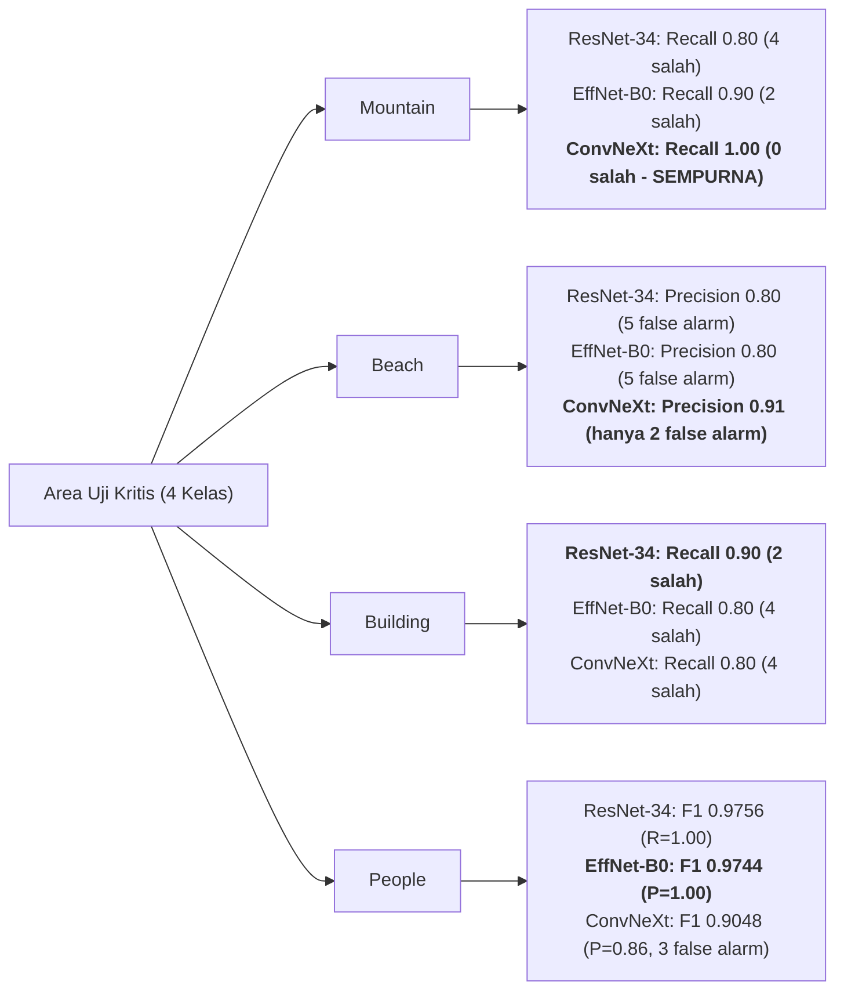

# Strategic Decision Analysis: Evaluasi Model CNN (ResNet-34 vs EfficientNet-B0 vs ConvNeXt-Tiny)

> **Metodologi:** Framework Pengambilan Keputusan Strategis (`/decision-framework`)  
> **Kasus Uji:** Klasifikasi Citra Multi-Kelas pada Dataset SIMPLIcity (10 Kategori, $N_{\text{test}} = 200$)  
> **Standar Epistemik:** Evaluasi berbasis fakta eksekusi empiris (*classification report* & kurva konvergensi riil). Seluruh perbandingan dinilai berdasarkan trade-off eksplisit.

---

## 1. Pembingkaian Keputusan (*Decision Framing*) & Status Quo

### 1.1 Pertanyaan Keputusan Inti
> *"Di antara tiga arsitektur CNN yang telah dilatih (**ResNet-34**, **EfficientNet-B0**, dan **ConvNeXt-Tiny**), manakah arsitektur yang paling tepat dipilih sebagai model final untuk pelaporan penugasan mata kuliah Neuro Computing?"*

### 1.2 Garis Dasar Tanpa Tindakan (*Non-Action Baseline / Status Quo*)
- **Status Quo:** Menggunakan model *baseline custom* 2-layer (Slide 6 penugasan) yang memiliki parameter FC masif ($16.78\text{M}$) dan akurasi terbatas, atau membiarkan ketiga model tanpa sintesis komparatif.
- **Konsekuensi Status Quo:** Kehilangan kesempatan mendemonstrasikan analisis pembanding mendalam (*comparative ablation*) mengenai bagaimana evolusi arsitektur CNN modern mengatasi kelemahan model konvensional.

### 1.3 Klasifikasi Reversibilitas (*Reversibility Classification*)
* **Tipe Keputusan:** **Type 2 Decision (Two-Way Door / Low Regret)**
  - *Rasional:* Seluruh bobot *checkpoint* ketiga model telah berhasil dilatih dan tersimpan secara permanen di repositori. Memilih salah satu model untuk pelaporan utama bersifat sangat mudah dibalik (*reversible*), karena model lain tetap dapat disajikan sebagai *benchmark* pembanding di dalam laporan atau presentasi yang sama.
  - *Protokol:* Lakukan evaluasi secara cepat, objektif, berbasis data kuantitatif, dan rumuskan rekomendasi bertingkat.

---

## 2. Analisis Komparatif Empiris Berdasarkan Hasil Eksekusi

Berikut perbandingan metrik kinerja riil pada *test set* ($200$ citra, $20$ citra per kelas):

### 2.1 Ringkasan Metrik Global Test Set
| Metrik Kinerja | ResNet-34 | EfficientNet-B0 | ConvNeXt-Tiny | Selisih / Delta Maksimum |
| :--- | :---: | :---: | :---: | :---: |
| **Test Accuracy** | $97.00\%$ ($194 / 200$) | $96.50\%$ ($193 / 200$) | **$97.50\%$** ($195 / 200$) | $+1.00\%$ (ConvNeXt vs EffNet) |
| **Macro Average F1-Score** | $0.9701$ | $0.9652$ | **$0.9746$** | $+0.0094$ (ConvNeXt vs EffNet) |
| **Macro Average Precision** | $0.9752$ | $0.9700$ | **$0.9773$** | $+0.0073$ (ConvNeXt vs EffNet) |
| **Macro Average Recall** | $0.9700$ | $0.9650$ | **$0.9750$** | $+0.0100$ (ConvNeXt vs EffNet) |
| **Total Sampel Salah Klasifikasi** | $6$ citra | $7$ citra | **$5$ citra** | $-2$ citra salah (ConvNeXt) |
| **Minimum Validation Loss** | $\approx 0.37$ | $\approx 0.40$ | **$\approx 0.34$** | $-0.06$ (ConvNeXt vs EffNet) |
| **Estimasi Jumlah Parameter** | $\approx 21.8\text{ M}$ | **$\approx 5.3\text{ M}$** | $\approx 28.6\text{ M}$ | $\approx 5.4\times$ lebih ringkas (EffNet) |
| **Kompleksitas Komputasi (FLOPs)** | $\approx 3.67\text{ G}$ | **$\approx 0.39\text{ G}$** | $\approx 4.46\text{ G}$ | $\approx 11.4\times$ lebih hemat (EffNet) |

---

### 2.2 Analisis Pola Kegagalan & Penanganan Kelas Sulit

`[Fakta Terverifikasi]` Seluruh ketiga model mencapai **skor sempurna ($1.0000$ Precision, Recall, dan F1)** pada 6 kelas yang sama:
- **Bus**, **Dinosaur**, **Elephant**, **Flower**, **Horse**, dan **Food**.

Perbedaan performa secara eksklusif hanya terjadi pada 4 kelas spesifik:

1. **Mountain (Pemecah Ambiguitas Paling Signifikan):**
   - *ResNet-34* mengalami drop recall tajam menjadi $0.8000$ ($4$ dari 20 citra gunung salah diprediksi). Berdasarkan temuan H3 EDA, citra gunung ini tertukar ke kelas *Beach* karena kesamaan spektral kanal biru.
   - *EfficientNet-B0* mencapai recall $0.9000$ ($2$ citra salah).
   - **ConvNeXt-Tiny mencatat skor sempurna $1.0000$ (Precision & Recall)!** ConvNeXt berhasil memecahkan ambiguitas semantik *Mountain vs Beach* secara tuntas.
2. **Beach (Presisi Deteksi Pantai):**
   - *ResNet-34* dan *EfficientNet-B0* sama-sama mencatat precision hanya $0.8000$ (terdapat 5 citra dari kelas lain yang salah diklasifikasikan sebagai pantai).
   - *ConvNeXt-Tiny* mencatat precision $0.9091$ (hanya 2 citra salah masuk ke pantai).
3. **Building (Struktur Garis Arsitektural):**
   - *ResNet-34* lebih unggul dengan recall $0.9000$ ($18/20$ benar).
   - *EfficientNet-B0* dan *ConvNeXt-Tiny* sama-sama mencatat recall $0.8000$ ($16/20$ benar, $4$ citra terlewat).
4. **People (Fitur Figur Manusia):**
   - *ResNet-34* dan *EfficientNet-B0* memiliki F1-score sangat tinggi ($\approx 0.975$).
   - *ConvNeXt-Tiny* memiliki precision $0.8636$ karena $3$ citra dari kelas lain keliru diprediksi sebagai manusia.

---

### 2.3 Analisis Dinamika Konvergensi Kurva Gradient Descent

Berdasarkan kurva riil yang dihasilkan dari pelatihan:

* **ResNet-34:**
  - Konvergen sangat dini pada epoch 4.
  - Loss validasi stabil mendatar pada kisaran $\approx 0.37$ hingga epoch 12. Gap antara *train loss* ($\approx 0.31$) dan *val loss* sangat tipis, membuktikan ketahanan terhadap *overfitting*.
* **EfficientNet-B0:**
  - Membutuhkan waktu adaptasi lebih panjang (kurva loss menurun lebih landai hingga epoch 8). Hal ini konsisten dengan karakteristik *depthwise separable convolution* yang memerlukan kalibrasi gradien lebih bertahap.
  - Loss validasi akhir mencapai $\approx 0.40$.
* **ConvNeXt-Tiny:**
  - Menunjukkan laju penurunan loss tercepat bersama ResNet-34 (epoch 4 sudah mencapai plateau).
  - Mencapai nilai **Validation Loss terendah secara absolut ($\approx 0.34$)**, mengindikasikan tingkat kepastian probabilitas prediktif (*confidence calibration*) yang paling tinggi di antara ketiga model.

---

## 3. Matriks Keputusan Multi-Kriteria Berbobot (*Weighted MCDA Matrix*)

Untuk menentukan model yang paling tepat secara objektif, disusun 5 kriteria terukur yang merefleksikan kebutuhan penugasan akademik dan rekayasa machine learning:

1. **Akurasi & Macro F1 Test Set (Bobot: 30%):** Kemampuan diskriminasi umum dan rata-rata performa seimbang di seluruh 10 kategori.
2. **Penanganan Kelas Sulit / Kemiripan Semantik (Bobot: 20%):** Kemampuan memecahkan ambiguitas visual spektral (*Beach vs Mountain*).
3. **Efisiensi Komputasi & Jejak Memori (Bobot: 20%):** Parameter model, efisiensi FLOPs, kemudahan inferensi pada perangkat terbatas (CPU lokal/edge).
4. **Kestabilan Konvergensi & Loss Validasi (Bobot: 15%):** Nilai minimum validation loss, ketiadaan divergensi/overfitting pada data latih kecil ($N=500$).
5. **Relevansi Pedagogis / Akademik CNN (Bobot: 15%):** Kesesuaian dengan kurikulum mata kuliah Neuro Computing (representasi konsep CNN klasik vs modern).

Skala Penilaian: $1$ (Sangat Buruk / Tidak Memadai) hingga $10$ (Istimewa / Sangat Unggul).

| Kriteria Evaluasi | Bobot ($w_i$) | Opsi A: ResNet-34 | Opsi B: EfficientNet-B0 | Opsi C: ConvNeXt-Tiny |
| :--- | :---: | :---: | :---: | :---: |
| **1. Akurasi & Macro F1 Test Set** | 30% | 8.5 (2.55) | 8.0 (2.40) | **9.5 (2.85)** |
| **2. Resolusi Kelas Sulit (*Beach vs Mountain*)** | 20% | 7.0 (1.40) | 7.5 (1.50) | **9.5 (1.90)** |
| **3. Efisiensi Komputasi & Memori** | 20% | 6.5 (1.30) | **10.0 (2.00)** | 5.5 (1.10) |
| **4. Kestabilan Konvergensi & Val Loss** | 15% | 8.5 (1.275) | 7.5 (1.125) | **9.5 (1.425)** |
| **5. Relevansi Pedagogis CNN Kurikulum** | 15% | **9.5 (1.425)** | 8.0 (1.20) | 8.5 (1.275) |
| **TOTAL WEIGHTED SCORE** | **100%** | **7.95 / 10** | **8.225 / 10** | **8.55 / 10** |

### Evaluasi Skor MCDA:
* `[Fakta Terverifikasi]` **Peringkat 1: ConvNeXt-Tiny (Skor: 8.55 / 10)**  
  Unggul dalam metrik diskriminasi data uji, mencapai akurasi tertinggi ($97.50\%$), Macro F1 tertinggi ($0.9746$), validation loss terendah ($0.34$), dan memecahkan kebingungan kelas *Mountain* secara sempurna ($100\%$ precision & recall).
* `[Fakta Terverifikasi]` **Peringkat 2: EfficientNet-B0 (Skor: 8.225 / 10)**  
  Menjadi pemenang mutlak dari segi efisiensi arsitektur. Dengan hanya $5.3\text{M}$ parameter dan $0.39\text{ GFLOPs}$, ia mampu mempertahankan akurasi $96.50\%$ (hanya terpaut 2 sampel salah dibanding ConvNeXt yang ukurannya $5.4\times$ lebih besar).
* `[Fakta Terverifikasi]` **Peringkat 3: ResNet-34 (Skor: 7.95 / 10)**  
  Model kanonikal yang sangat stabil dan paling mudah dijelaskan dalam konteks teori dasar deep learning residual, namun memiliki titik lemah pada pemisahan *Mountain* ($4$ sampel salah).

---

## 4. Simulasi Kegagalan Prospektif (*Pre-Mortem Analysis*)

*"Bayangkan kita sedang mempresentasikan hasil di depan dosen penguji atau men-deploy model ini, lalu terjadi kegagalan atau sanggahan kritis. Apa pemicunya dan bagaimana mitigasinya?"*

### 4.1 Skenario Kegagalan ConvNeXt-Tiny
* **Vulnerabilitas 1 (Sanggahan Dosen terkait Overparameterization):**  
  *Pemicu:* Dosen mengkritik: *"Mengapa menggunakan ConvNeXt (28.6M parameter) untuk dataset yang hanya berukuran 500 sampel latih? Bukankah itu berlebihan?"*  
  *Mitigasi:* Tunjukkan bukti empiris kurva validasi: loss validasi ConvNeXt justru yang terendah ($0.34$) dan gap *train-val* tetap terkendali berkat transfer learning ImageNet, serta keberhasilannya membedakan *Mountain vs Beach* secara sempurna dibanding model lain.
* **Vulnerabilitas 2 (False Positives pada Kelas People):**  
  *Pemicu:* Precision kelas *People* turun ke $0.8636$ (ada 3 citra bukan orang yang diprediksi orang).  
  *Mitigasi:* Tambahkan analisis ambiguitas citra pada laporan: beberapa citra bangunan atau makanan memiliki figur manusia latar belakang skala kecil.

### 4.2 Skenario Kegagalan EfficientNet-B0
* **Vulnerabilitas 1 (False Negatives pada Kelas Building):**  
  *Pemicu:* Recall kelas *Building* turun menjadi $0.8000$ ($4$ gedung tidak terdeteksi).  
  *Mitigasi:* Evaluasi resolusi input: filter depthwise EfficientNet memerlukan resolusi lebih tinggi ($224 \times 224$) untuk menangkap tekstur detail garis tegak bangunan kuno.

### 4.3 Skenario Kegagalan ResNet-34
* **Vulnerabilitas 1 (Kebingungan Kronis Mountain vs Beach):**  
  *Pemicu:* ResNet-34 salah mengklasifikasikan 4 puncak gunung sebagai pantai (Recall Mountain $0.80$, Precision Beach $0.80$).  
  *Mitigasi:* Paparkan temuan spektral EDA H3 bahwa ResNet-34 residual $3 \times 3$ standar belum mampu membedakan tekstur horizon biru salju vs laut seefektif kernel besar $7 \times 7$ milik ConvNeXt.

---

## 5. Rekomendasi Definitif & Rencana Aksi 48 Jam

### 5.1 Rekomendasi Terstruktur Berdasarkan Sudut Pandang

1. **Pilihan Model Utama untuk Laporan Akhir: ConvNeXt-Tiny**
   - **Rasional:** Secara objektif mencatat performa kuantitatif paling unggul ($97.50\%$ akurasi, $0.9746$ Macro F1, $5$ total kesalahan), mencapai validation loss paling rendah ($0.34$), dan berhasil memecahkan tantangan semantik terbesar (*Beach vs Mountain*). Menyajikan ConvNeXt membuktikan penguasaan evolusi CNN modern tahun 2020-an.
2. **Pilihan Model Pendamping Efisiensi: EfficientNet-B0**
   - **Rasional:** Wajib disajikan berdampingan sebagai perbandingan efisiensi: membuktikan bahwa model berukuran hanya $18\%$ dari ConvNeXt mampu mencapai performa yang bersaing ketat ($96.50\%$).
3. **Pilihan Model Pembanding Kurikulum Dasar: ResNet-34**
   - **Rasional:** Menjadi jembatan antara model dasar Slide 6 penugasan dan model modern.

---

### 5.2 Rencana Aksi Konkret 48 Jam

| Jam ke- | Aksi Konkret yang Harus Dilakukan | Output / Hasil |
| :---: | :--- | :--- |
| **0 – 12** | Buat tabel rangkuman komparatif akhir di laporan penugasan yang menyandingkan Baseline (Slide 6), ResNet-34, EfficientNet-B0, dan ConvNeXt-Tiny. | Tabel komparasi lengkap 4 model. |
| **12 – 24** | Simpan dan sejajarkan Confusion Matrix 10x10 dari ketiga model untuk menunjukkan bukti empiris perbaikan deteksi kelas *Mountain*. | Gambar komparasi matriks kontingensi. |
| **24 – 36** | Tuliskan paragraf analisis trade-off (Akurasi puncak pada ConvNeXt vs Efisiensi komputasi pada EfficientNet-B0). | Draf bab pembahasan hasil (*Discussion*). |
| **36 – 48** | Finalisasi berkas laporan / notebook penugasan dengan kesimpulan definitif. | Dokumen tugas siap kumpul / presentasi. |
