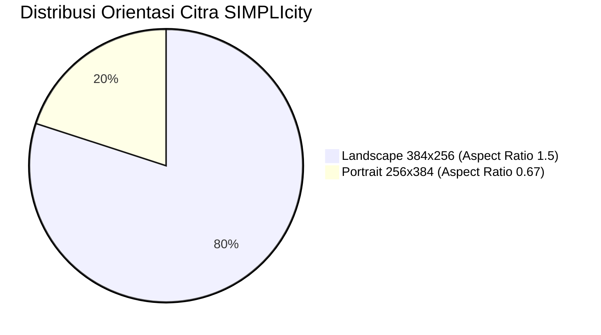
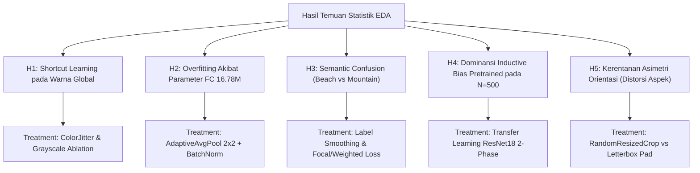
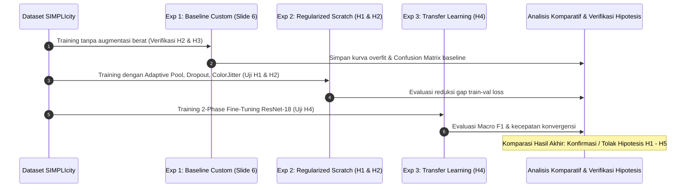

# Exploratory Data Analysis (EDA) & Hypothesis Generation Report: SIMPLIcity Dataset

> **Domain:** Computer Vision & Neuro Computing  
> **Dataset:** SIMPLIcity (Corel-1000 Subset, 10 Kategori Semantik, $N=1.000$)  
> **Tujuan Dokumen:** Memetakan karakteristik statistik, mendeteksi potensi *shortcut learning*, dan merumuskan hipotesis eksperimental terukur untuk memandu perancangan model CNN.  
> **Pernyataan Epistemik:** Seluruh korelasi dan perbedaan distribusi yang dilaporkan dalam dokumen ini **mengindikasikan asosiasi statistik, bukan hubungan sebab-akibat**.

---

## 1. Metadata & Ringkasan Integritas Dataset

Berdasarkan audit komputasional langsung pada direktori `Dataset/SIMPLIcity`:

* `[Fakta Terverifikasi]` **Total Populasi Sampel:** Tepat $1.000$ berkas citra berformat JPEG RGB.
* `[Fakta Terverifikasi]` **Distribusi Partisi Eksperimen (Sesuai Slide 4 Penugasan):**
  - **Train:** $500$ citra ($50$ citra/kelas, kode rentang `x00` - `x49`).
  - **Validation:** $300$ citra ($30$ citra/kelas, kode rentang `x50` - `x79`).
  - **Test:** $200$ citra ($20$ citra/kelas, kode rentang `x80` - `x99`).
  - *Distribusi kelas seimbang sempurna ($10\%$ per kelas pada setiap split).*
* `[Fakta Terverifikasi]` **Kesehatan Berkas:**
  - Citra korup / 0-byte: $0$ berkas (`corrupt_count = 0`).
  - Duplikasi identik (MD5 hash): $0$ berkas (`duplicate_hashes = 0`).
  - Format warna: $100\%$ RGB 3-kanal (rentang nilai intensitas piksel $[0, 255]$).

---

## 2. Profiling Geometri & Dimensi Spasial

### 2.1 Distribusi Resolusi & Rasio Aspek
Dataset tidak memiliki resolusi seragam, melainkan terbagi ke dalam dua pola orientasi diskret:

* `[Fakta Terverifikasi]` **Landscape:** $800$ citra berdimensi $384 \times 256$ piksel (Rasio aspek $= 1.50$).
* `[Fakta Terverifikasi]` **Portrait:** $200$ citra berdimensi $256 \times 384$ piksel (Rasio aspek $\approx 0.67$).

### 2.2 Asimetri Orientasi per Kategori Semantik
Pemeriksaan tabulasi silang (*cross-tabulation*) antara kategori semantik dan orientasi kamera menunjukkan variasi yang signifikan:

| Kategori Semantik | Indeks | Jumlah Landscape | Jumlah Portrait | Proporsi Portrait (%) | Karakteristik Komposisi Spasial |
| :--- | :---: | :---: | :---: | :---: | :--- |
| **Dinosaur** | 4 | 100 | 0 | $0.0\%$ | Citra model terisolasi, $100\%$ horizontal |
| **Bus** | 3 | 98 | 2 | $2.0\%$ | Kendaraan memanjang, hampir murni horizontal |
| **Flower** | 6 | 92 | 8 | $8.0\%$ | Foto makro terpusat, mayoritas horizontal |
| **Elephant** | 5 | 85 | 15 | $15.0\%$ | Panorama alam liar/savana |
| **Beach** | 1 | 83 | 17 | $17.0\%$ | Garis horizon pantai dan laut mendatar |
| **Horse** | 7 | 80 | 20 | $20.0\%$ | Lanskap padang rumput |
| **Building** | 2 | 71 | 29 | $29.0\%$ | Menara, gedung tinggi, dan monumen vertikal |
| **Mountain** | 8 | 65 | 35 | $35.0\%$ | Puncak gunung bersalju dan lembah curam |
| **Food** | 9 | 64 | 36 | $36.0\%$ | Penataan meja makan / sajian vertikal |
| **People** | 0 | 62 | 38 | $38.0\%$ | Potret manusia berdiri tegak (*full-body portrait*) |

> `[Fakta Terverifikasi]` Terdapat asosiasi statistik kuat antara kategori tertentu dengan orientasi kamera: *Dinosaur* ($0\%$ portrait) dan *Bus* ($2\%$ portrait) sangat didominasi orientasi landscape, sedangkan *People* ($38\%$), *Food* ($36\%$), dan *Mountain* ($35\%$) memiliki proporsi portrait tertinggi.

---

## 3. Profiling Spektral, Fotometrik, dan Ukuran Berkas

Analisis statistik intensitas piksel kanal RGB ($\mu_R, \mu_G, \mu_B$), rata-rata kecerahan (*brightness*), dan ukuran berkas terkompresi (*JPEG file size*) menghasilkan profil berikut:

| Kategori | $\mu_{\text{Red}}$ | $\mu_{\text{Green}}$ | $\mu_{\text{Blue}}$ | Rata-rata Kecerahan | Ukuran Berkas Rata-rata (KB) | Ciri Dominan Spektral & Tekstur |
| :--- | :---: | :---: | :---: | :---: | :---: | :--- |
| **Dinosaur** | **205.12** | **200.22** | **192.24** | **200.78** | **13.74** | Sangat terang, latar putih netral, kompresi JPEG tinggi |
| **Elephant** | 133.88 | 129.35 | 113.88 | 128.94 | 35.49 | Cerah kecokelatan, langit gurun/savana |
| **Food** | 118.70 | 90.29 | 70.94 | 96.58 | 29.94 | Hangat (Red mendominasi), variasi warna hidangan |
| **People** | 107.34 | 91.57 | 80.69 | 95.04 | 35.01 | Hangat, rona kulit tanah, busana tradisional |
| **Beach** | 98.85 | 109.46 | **116.27** | 107.06 | 29.92 | Kanal Biru tertinggi (langit & lautan) |
| **Mountain** | 95.15 | 105.63 | **117.81** | 103.88 | 30.99 | Kanal Biru tertinggi (langit & salju pegunungan) |
| **Building** | 97.96 | 98.62 | 100.88 | 98.68 | 27.90 | Netral seimbang (dinding batu/arsitektur abu-abu) |
| **Bus** | 101.02 | 88.49 | 91.72 | 92.61 | 29.99 | Bervariasi, kendaraan warna-warni di jalan kota |
| **Horse** | 84.47 | **103.19** | 58.22 | 92.47 | **39.70** | Kanal Hijau tertinggi (padang rumput), tekstur kompleks |
| **Flower** | 83.27 | 47.95 | 41.45 | **57.77** | 18.79 | Sangat gelap, fokus makro warna bunga dengan bokeh gelap |

```mermaid
xychart-beta
    title "Rata-rata Intensitas Kanal Warna RGB per Kelas"
    x-axis ["People", "Beach", "Build", "Bus", "Dino", "Eleph", "Flow", "Horse", "Mount", "Food"]
    y-axis "Intensitas Piksel (0 - 255)" 0 --> 220
    bar [107.3, 98.9, 98.0, 101.0, 205.1, 133.9, 83.3, 84.5, 95.2, 118.7]
    bar [91.6, 109.5, 98.6, 88.5, 200.2, 129.4, 48.0, 103.2, 105.6, 90.3]
    bar [80.7, 116.3, 100.9, 91.7, 192.2, 113.9, 41.5, 58.2, 117.8, 70.9]
```

### Analisis Temuan Spektral Kunci:
1. **Pemisahan Ekstrem Kelas Dinosaur:**  
   `[Fakta Terverifikasi]` Kelas *Dinosaur* memiliki nilai kecerahan rata-rata $200.78$ dan ukuran berkas JPEG rata-rata hanya $13.74\text{ KB}$ (paling rendah). Hal ini mencerminkan latar belakang putih polos yang seragam dan mudah dikompresi.
2. **Kesesuaian Spektral Semu Antara Beach dan Mountain:**  
   `[Fakta Terverifikasi]` Profil warna kelas *Beach* ($\mu_R=98.85, \mu_G=109.46, \mu_B=116.27$) dan *Mountain* ($\mu_R=95.15, \mu_G=105.63, \mu_B=117.81$) menunjukkan kemiripan statistik yang sangat dekat (selisih $\le 4$ unit pada setiap kanal). Keduanya didominasi oleh kanal Biru.
3. **Dominansi Latar Belakang Hijau pada Horse:**  
   `[Fakta Terverifikasi]` Kelas *Horse* adalah satu-satunya kelas di mana kanal Hijau mendominasi secara signifikan di atas Merah dan Biru ($\mu_G = 103.19$ vs $\mu_B = 58.22$), mencerminkan rumput lapangan terbuka. Ukuran berkas rata-ratanya paling besar ($39.70\text{ KB}$), mengindikasikan densitas tekstur spasial yang tinggi.
4. **Karakteristik Makro Kontras pada Flower:**  
   `[Fakta Terverifikasi]` Kelas *Flower* memiliki nilai kecerahan rata-rata terendah ($57.77$), dengan kanal Hijau dan Biru yang tertekan ($<48$).

---

## 4. Matriks Generasi Hipotesis Eksperimental (H1 - H5)

Berdasarkan temuan data di atas, dirumuskan lima hipotesis teruji untuk memandu perancangan model dan perlakuan data (*data treatments*):

---

### Hipotesis 1 (H1): Risiko *Shortcut Learning* Berbasis Warna Global
* **Pernyataan Hipotesis:**  
  `[Hipotesis]` Model CNN konvensional tanpa augmentasi fotometrik agresif rentan mengklasifikasikan kelas seperti *Dinosaur* (kecerahan $>190$), *Horse* (dominan hijau), dan *Flower* (dominan merah berlatar gelap) berdasarkan histogram warna global, bukan fitur morfologi objek.
* **Mekanisme Uji Eksperimental:**
  1. *Baseline Group:* Pelatihan tanpa jitter warna.
  2. *Treatment Group:* Pelatihan dengan `ColorJitter(brightness=0.25, contrast=0.25, saturation=0.25)` dan `RandomErasing(p=0.20)`.
  3. *Ablation Check:* Evaluasi performa model pada citra uji yang dikonversi ke Grayscale (1-kanal). Jika akurasi model *baseline* anjlok drastis sementara model *treatment* relatif stabil, hipotesis *color shortcut* terkonfirmasi.

---

### Hipotesis 2 (H2): *Overfitting* Cepat pada Arsitektur Baseline (Slide 6)
* **Pernyataan Hipotesis:**  
  `[Hipotesis]` Arsitektur baseline Slide 6 memicu divergensi kurva validasi (*validation loss divergence*) dalam $\le 10$ epoch pertama akibat kapasitas representasi berlebih ($16.78\text{M}$ parameter FC pada $500$ sampel latih). Penggantian lapisan *flattening* mentah dengan *Adaptive Average Pooling* ($2 \times 2$) akan mereduksi gap antara *train loss* dan *validation loss*.
* **Mekanisme Uji Eksperimental:**
  1. Latih `baseline_custom` (16.78M parameter) vs `custom_scratch` (150k parameter) dengan optimizer dan learning rate yang sama (AdamW, $\text{lr}=10^{-3}$).
  2. Ukur selisih $\Delta = \mathcal{L}_{\text{val}} - \mathcal{L}_{\text{train}}$ pada epoch ke-20.

---

### Hipotesis 3 (H3): Pasangan Konfusi Dominan (*Beach* vs *Mountain*)
* **Pernyataan Hipotesis:**  
  `[Hipotesis]` Tingkat kesalahan saling silang (*cross-class misclassification rate*) tertinggi pada matriks kontingensi akan terjadi antara pasangan kelas *Beach* dan *Mountain*, akibat kemiripan profil spektral kanal biru dan komposisi horizon alam terbuka.
* **Mekanisme Uji Eksperimental:**
  1. Analisis elemen non-diagonal pada Confusion Matrix 10x10 pada data uji ($200$ citra).
  2. Uji intervensi: Penerapan *Label Smoothing* ($\epsilon = 0.10$) untuk meredam kepastian probabilitas ekstrem pada kedua kelas tersebut.

---

### Hipotesis 4 (H4): Efektivitas *Transfer Learning* pada Rezim Sampel Kecil
* **Pernyataan Hipotesis:**  
  `[Hipotesis]` Penggunaan bobot awal ImageNet (*Pretrained ResNet-18*) akan menghasilkan konvergensi validasi lebih stabil dan *Macro F1-Score* lebih tinggi dibanding model yang dilatih dari nol (*from scratch*), karena representasi filter tingkat rendah (deteksi tepi dan gradien warna) telah terbentuk secara terpisah dari 500 sampel SIMPLIcity.
* **Mekanisme Uji Eksperimental:**
  1. Komparasikan `resnet18_transfer` (pretrained) vs `custom_scratch` pada kondisi jumlah epoch yang sama ($30$ epoch).
  2. Catat jumlah epoch yang diperlukan untuk mencapai $\text{Val Accuracy} \ge 80\%$.

---

### Hipotesis 5 (H5): Dampak Distorsi Geometri Akibat *Anisotropic Resizing*
* **Pernyataan Hipotesis:**  
  `[Hipotesis]` Melakukan *resize* langsung citra non-persegi ($384 \times 256$ dan $256 \times 384$) ke resolusi persegi ($128 \times 128$) mengubah rasio aspek objek secara artifisial, yang menurunkan *recall* pada kelas-kelas berorientasi *portrait* (seperti *People*, *Food*, dan *Building*).
* **Mekanisme Uji Eksperimental:**
  1. Eksperimen Kontrol: `Resize((128, 128))` langsung.
  2. Eksperimen Perlakuan: *Letterboxing / Pad-to-Square* (mempertahankan rasio aspek asli dengan bantalan piksel netral) sebelum di-resize.
  3. Bandingkan nilai *Recall* spesifik pada kelas *People*, *Building*, dan *Food*.

---

## 5. Rekomendasi Alur Eksperimen Terstruktur

Untuk memvalidasi hipotesis di atas secara metodologis, alur kerja eksperimen disusun ke dalam empat tahapan logis:

Dokumen ini menjadi rujukan empiris untuk menginterpretasikan kurva konvergensi *gradient descent* dan matriks kontingensi yang dihasilkan oleh setiap skrip pelatihan dalam repositori.
